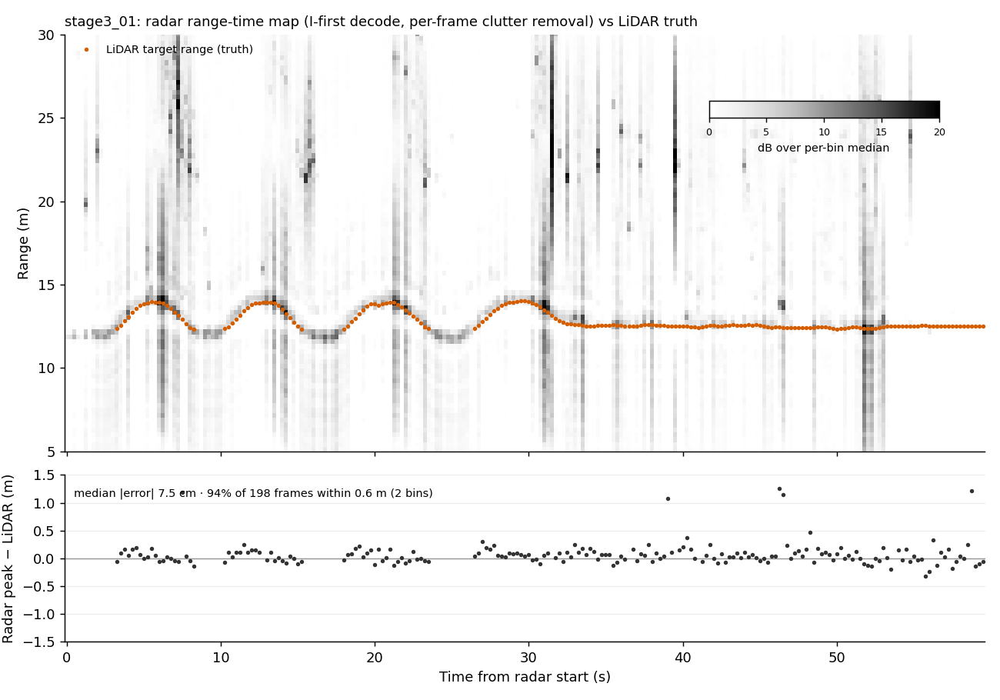

# Cascade radar raw-data investigation: r075m

Windows build station, 2026-10-10. Nothing has been flashed.

Source paths below are relative to these roots:

- `FW/` = `C:\ti\mmwave_mcuplus_sdk_04_04_00_01\mmwave_mcuplus_sdk_04_04_00_01\ti\utils\test\cascade - Copy\am273x\` at the time of writing. **Since 2026-10-12:** `firmware/am273x_cascade/am273x/` in this repo (reached from the SDK through the `cascade_radar` junction). The old folder was removed; its history is on the `archive/history-before-2026-10-12` branch.
- `MCU/` = `C:\ti\mmwave_mcuplus_sdk_04_04_00_01\mcu_plus_sdk_am273x_08_05_00_24\`
- `W/` = `...\mmwave_mcuplus_sdk_04_04_00_01\ti\`

Line numbers are for the files as they are now, after the fix. Only `main_mss.c` (+11 lines near the top of `main()`, +1 include) and `cascade_config.h` changed. The untouched originals are in `investigation/source_backup_before_fix/`.

**The source is the flashed firmware.** Rebuilding `CASCADE_CFG_R075M` from the unmodified source reproduced the flashed image bit for bit: `.appimage` md5 `f0e6a73d4c7d35d92e2128305f0b1867` and `.rprc` md5 `965d89a0b5fe16e7c44468acfeedd2d0`. Every statement about the source below therefore describes exactly what the radar runs.

---

## 0. Summary

| | |
|---|---|
| **Root cause of the constant blocks** | Not compression. The AM273x receives each chirp from the two AWR2243s over CSI-2 into four 4 KB ping/pong buffers in **DSS L3 RAM** and re-streams them over LVDS. When the image boots from QSPI, nobody runs the DSS L3 hardware memory-init (MEMINIT). In that state about **half of the 32-byte lines of those buffers never take the CSI-2 data**. The CBUFF streams whatever the lines held at power-up, and it streams the same garbage in every chirp of every frame. Loading through CCS hid the defect because the CCS GEL script runs DSS L3 MEMINIT on connect. |
| **Proof from the frames** | The constant mask repeats with a period of **exactly 2 chirps** (ping/pong). It is all-or-nothing per **32-byte** block. The constant words are **bit-identical in all 192 even (or odd) chirps of a frame**, not just across frames. Their statistics are those of **uniform random int16** (std 18,884; theory 18,918). The pattern is **different after each power-up** (stage3_01 and ipad_test_01 agree at chance level). |
| **Fix** | `SOC_rcmStartMemInitDSSL3/WaitMemInitDSSL3(ALL)` at the start of `main()` (`FW/main_mss.c:643-644`). Built into two new images, `r075m_v2` (4 fps) and `r075m_v2_8fps` (8 fps). Both use the HPF floor the operator chose: 175/350 kHz, giving 2.62 m. **Confirmed on hardware 2026-10-10**: 0.00% stale words, holding across a power cycle (§8). Every other range variant was then rebuilt with the fix (§10). |
| **Format** | int16 LE, **I first**, `[loop 64][tx 6][dev 2][rx 4][sample 256][I,Q]`, 3,145,728 B per frame, 250 ms. The Jetson layout is correct. `radar_config.py`'s Q-first (from the `.cfg`) is **wrong**. |
| **Decode check** | Decoding stage3_01 with the format above, plus per-frame clutter removal (which cancels the stale words exactly), tracks the LiDAR target: **median error 7.5 cm, 94% of 198 frames within 0.6 m** (figure in §4). |
| **Streaks** | Range-sidelobe leakage caused by the ~50% gapped sampling. A strong moving return spreads to a −22…−26 dB floor across all ranges; without the gaps the floor would be −97 dB. Not interference, not cascade sync. |
| **908 pkt/s episode** | Not reproducible from the data provided. The firmware design explains it as the AM273x streaming only ~1 in 9.5 chirps (§5). The fix does not address it. |

---

## 1. What r075m actually streams

| Item | Value | Source |
|---|---|---|
| Data type | Raw ADC, complex 1x, 16-bit (`b2AdcBits 2`, `b2AdcOutFmt 1`) | `FW/common.c:382-383`, `FW/cascade_config.h:96-97` |
| AWR2243 → AM273x | CSI-2 (`intfSel 0`), ADC only (`transferFmtPkt0 1`), 4 lanes (`laneEn 0xF`, `lanePosPolSel 0x35421`), 600 Mbps DDR | `FW/common.c:386-409` |
| Compression | **None.** No compression call anywhere in the firmware, the mmWave control layer or the generated driver config | `grep -i compress` over `FW/*.c *.h` and `W/control/mmwave/src`: no hits |
| I/Q order | **I first** (`iqSwapSel = 0`) | `FW/main_mss.c:357`; meaning in `W/control/mmwavelink/include/rl_device.h:662-667` |
| Channel order | Non-interleaved: each RX's 256 samples contiguous (`chInterleave = 1`) | `FW/main_mss.c:358`; `rl_device.h:645-651` |
| CSI-RX | Each CSI-2 line is one chirp of one device: 256 × 4 RX × 4 B = 4096 B. Hardware ping/pong switches every line. | `FW/mssgenerated/ti_drivers_open_close.c:383-385, 436-438` |
| Buffers | `CSIA_Ping/Pong` (dev0), `CSIB_Ping/Pong` (dev1), 4 KB each, section `.l3ram` → **DSS_L3 @ 0x88000000-0x88003FFF** | `FW/main_mss.c:118-124`, `FW/mss_linker.cmd:12`, `am273x_cascade_mss.map` (`.l3ram 0x88000000 UNINITIALIZED`) |
| LVDS out | CBUFF SW session, 2 user buffers (CSIA then CSIB) of 2048 × 16-bit each, i.e. 8192 B per chirp. No header (`CBUFF_DataType_REAL`). 4 lanes, 16-bit, DDR, MSB first. | `FW/cascade_lvds_stream.c:187-194, 441-449`, `FW/main_mss.c:558-561` |
| Per-chirp trigger | CSI-RX A end-of-line ISR. The first one activates the session; each later one flips the CBUFF source between ping and pong in software and re-triggers. | `FW/cascade_csirx.c:184-217`, `FW/main_mss.c:592-620` |
| Chirp order | chirp = loop × 6 + tx. tx 0–2 = dev0 TX0–2, tx 3–5 = dev1 TX0–2 (one TX per chirp). Both devices sample every chirp. | `FW/common.c:516-560` |
| Bytes per frame | 384 × 8192 = **3,145,728** | — |
| Frame period | 250 ms × 200,000 = 50,000,000 (5 ns LSB); infinite frames; dev0 master trigger, dev1 slave | `FW/cascade_config.h:352` (R075M), `FW/common.c:644-649`; confirmed in the disassembly (`movw/movt 0x02FAF080`) |
| Profile | 76 GHz, idle 4 µs, ADC start 3 µs, ramp 31 µs, slope 414 (19.9878 MHz/µs), 256 samples at 10 Msps, HPF 2/2 (350 kHz / 1.4 MHz), 42 dB | `FW/cascade_config.h:339-352`, `FW/common.c:200-220` |

---

## 2. Root cause of the constant blocks

### 2.1 What the frames show

Analysis scripts are in `investigation/analysis/`; `check_radar_session.py` repeats the key tests.

1. **53.52%** of int16 values are identical in all 239 stage3_01 frames (**50.59%** in ipad_test_01).
2. Reshaped to `[384 chirps, 4096 int16]`, the constant mask of **every even chirp is identical**, and so is the mask of every odd chirp. Even 54.7% constant, odd 52.3%, overlap 28.5% ≈ 0.547 × 0.523, so the two masks are independent. The odd/even split is the CSI-RX hardware ping/pong.
3. Within a chirp, every 16-int16 (32-byte) block is either fully constant or fully varying. No block is partial.
4. **The constant values are the same in every even chirp of the same frame.** They are not merely constant over time: the CBUFF reads the same memory content 192 times per frame.
5. Constant values have mean |x| 16,285 and std 18,884, with all 256 byte values present. That is uniform random int16 (16,384 / 18,918). Real samples are about 127 counts outdoors and 19 indoors; the global peak is about 700.
6. The ipad_test_01 mask agrees with stage3_01 only at chance (52% / 49%). Where both are constant, 38–41% of the values agree, which is typical of SRAM power-up states (biased cells). The pattern is therefore **fixed per power-up**, not by addressing.
7. Per virtual channel, a fixed 45–48% of samples are real data, and the rest are stale.

Together these rule out compression (H1), a lane or format mismatch (H2) and a layout error (H3). A compressor or a lane swap would give the same pattern on every boot, and would not reproduce identical values 192 times inside one frame.

### 2.2 Why the firmware does this

- The four buffers are in DSS L3 RAM, declared `UNINITIALIZED`. Nothing in the application writes them (`FW/main_mss.c:118-124`).
- With the MPU configuration, DSS L3 is **non-cacheable** (`FW/mssgenerated/ti_dpl_config.c`: only the 4 GB background region covers 0x88000000, with `isCacheable = 0`). The R5F cache is therefore not involved.
- **The SBL never initialises DSS L3 for this image.** `MCU/source/drivers/bootloader/soc/am273x/bootloader_soc.c:201-231` runs `SOC_rcmStartMemInitDSSL3` only on the C66x path. Even there it is guarded by `gR5ss0MemInitDone`, which the R5 path has already set. This image is MSS-only, so DSS L3 starts with power-up contents.
- **CCS loading does initialise it.** `C:\ti\ccs2050\ccs\ccs_base\emulation\boards\evm_am273x\gel\evmam273x.gel:699-703` (`OnTargetConnect` → `doAll`) calls `memInitDSSL3()` (line 3116). The May–June sessions were loaded through CCS (`docs/FIRMWARE_PACKAGING_WINDOWS.md` §8: "This machine's CCS-based load path was a proof of concept"). The switch to QSPI boot introduced the defect, which also explains why all variants in `firmware_map.json` are affected.

**Inferred mechanism (not verified on hardware).** DSS L3 RAM is ECC-protected. Uninitialised data has random check bits. With a SECDED code, roughly half of random words decode as uncorrectable (even-weight syndrome), and partial writes into such words, which need a read-modify-write, do not land. That matches the ~50% fraction, the all-or-nothing 32-byte granularity and the per-boot randomness. The TRM text needed to prove it is not available on this machine. The fix does not depend on the exact mechanism: it is the TI SDK's own initialisation step (the SBL's C66 path and the GEL use the same call), and it puts L3 in the same state the working CCS sessions had.

### 2.3 Fix

`FW/main_mss.c:634-644` adds the following right after `System_init(); Board_init();` and before any task or L3 use:

```c
SOC_rcmStartMemInitDSSL3(SOC_RCM_MEMINIT_DSSL3_MEMBANK_ALL);
SOC_rcmWaitMemInitDSSL3(SOC_RCM_MEMINIT_DSSL3_MEMBANK_ALL);
```

The code runs from MSS L2 (0x1022xxxx), so zeroing L3 cannot hurt it. L3 holds only `.l3ram` and `.MCPILogBuffer`, both uninitialised by design. Both new images link `SOC_rcmStartMemInitDSSL3` and `SOC_rcmWaitMemInitDSSL3`; the r075m image does not.

---

## 3. Verdicts on the hypotheses

| # | Hypothesis | Verdict | Evidence |
|---|---|---|---|
| 1 | Compression enabled | **Ruled out.** | No compression configuration exists in the firmware path (§1). "8 range bins per block" is the mmW-demo HWA compression of range-FFT data, which this image does not run. The AWR2243 sends raw ADC and the AM273x forwards it untouched. The varying words are clean raw ADC: a plain range FFT on them tracks the LiDAR to 7.5 cm (§4). The constant words are uniform garbage, repeated 192× per frame (§2.1). The `compressionCfg … 1 …` line was never sent anywhere. The "compression confirmed" note of 2026-05-16 (`testing/…/20260516_011932_s01_validation_e1_compression_confirmed.md`) belongs to a different setup; the matching warning in `radar_config.py` does not apply to this firmware. |
| 2 | Lane or format mismatch radar ↔ DCA1000 | **Ruled out.** | AM273x CBUFF: LVDS, 4 lanes, 16-bit, DDR, no header (`FW/cascade_lvds_stream.c:187-194`). Jetson `CONFIG_FPGA 01 01 01 02 03 1E` = raw, 4-lane, LVDS capture, Ethernet, 16-bit, 30 s, the same as the Windows `cf_cascade.json` (raw, `lvdsMode 1`, `dataFormatMode 3`). `hsiLaneConfig`/`hsiClockConfig`/`dataFormatConfig` describe the AWR2243 → AM273x CSI-2 hop, not the DCA link. A lane mismatch would corrupt every word on every boot in the same way; here half the words are perfect raw ADC. |
| 3 | Frame layout or I/Q order differs | **Layout confirmed; I/Q settled as I first.** | Firmware: `iqSwapSel 0`, `chInterleave 1` (`FW/main_mss.c:357-358`). Data: the I-first decode tracks the LiDAR (94% of frames within 2 bins); Q-first puts the target in the mirrored half (1.5%). The energy split is 2.91 for I-first vs 0.34 for Q-first. `capture/config.py` (I-first) is right. `radar_config.py` is wrong for r075m, because the old `.cfg` had `adcbufCfg -1 0 1 0 1` (SampleSwap = 1 selects Q-first). |
| 4 | `.cfg` does not match the firmware | **Confirmed, several fields.** | `frameCfg … 50 …` (real: 250 ms; the map and measured 4.00 fps were right). `adcbufCfg` SampleSwap 1 (real: 0), which silently mirrors the spectrum in `radar_config.py`. `compressionCfg` enabled (real: none). `dataPathConfig` CQ sizes 64/64/64 (real: 132/132/72; inert). The axis-relevant fields (`profileCfg`, `frameCfg` loops/chirps) were correct, so range and Doppler axes were labelled right. In `firmware_map.json`, `hpf1_floor_m` was 2× too large for every variant with HPF1 register 2 (700 kHz was used instead of 350 kHz). Minor: `radar_config.py` uses c = 3e8, a 0.07% scale error. All corrected (§7). |
| 5 | Cause of the 908 pkt/s episode | **Probable, not proven** (§5). | — |
| 6 | Broadband streaks | **Explained: leakage from the stale-sample gaps.** | Streak frames 24–29 (6–7.25 s), 124/126 (31–31.5 s) and 158 (39.5 s) match the reported 7, 31.5 and 40 s. None has a chirp-localised burst (no chirp-device pair above 20× the frame median, which interference would produce). None clips (peak 773 counts). The excess energy sits at the range of a strong moving return (13.8 m, or 22–26 m: a second mover or multipath) and leaks everywhere else at −21…−27 dB relative to it. Passing a synthetic tone through the actual 48-channel stale mask gives a far-sidelobe floor of −26 dB median (−22.6 dB worst), against −97 dB without the mask. A cascade LO or frame-sync fault would decorrelate dev0 and dev1 continuously, not only when a strong return is present. Expect these streaks to vanish with the fix. |

---

## 4. Decode check against ground truth (stage3_01)



Decode: I first, `[64 loops][6 tx][2 dev][4 rx][256]`. Subtracting the per-frame mean over the 64 loops removes static clutter and cancels the stale words exactly (they are the same in every loop). Then a Hann-windowed 256-point range FFT, with power summed over loops and channels. Bin = 0.29294 m.

| Phase (truth file) | Truth range | Radar median \|error\| |
|---|---|---|
| 0–30 s, walking | 12.31–14.03 m, 4 round trips | 0.071 m |
| 30–50 s | 12.37–13.97 m (one excursion to 14 m at 30 s, then ~12.5 m) | 0.074 m |
| 50–60 s, standing | 12.34–12.54 m | 0.104 m |
| All 198 known frames | — | **0.075 m**; 94% within 0.6 m; outliers are streak frames |

Run `investigation/check_radar_session.py ../sessions/stage3_01` to reproduce.

The decode works despite the defect only because the target moves and the stale words are frame-constant. A static scene, Doppler and angle processing all suffer from the missing ~50% of samples per channel. The azimuth check against the LiDAR (7–17°) was **inconclusive** (best case 4.7° median error, correlation +0.07). The TX/RX → azimuth table in `JETSON_DATA_FORMAT.md` is therefore unverified and should be checked on the first good session.

---

## 5. Finding B: ~908 pkt/s, ~330 KB bursts

908 pkt/s ÷ 4 bursts/s × 1456 B ≈ 330 KB per frame. That is **~40 of 384 chirps** (8192 B each), so about **1 chirp in 9.5** was streamed. The frame cadence stayed intact.

What can produce this:

- **The CBUFF transfer size is fixed** at 8192 B per trigger (`FW/cascade_lvds_stream.c:442-449`), and there is no per-frame header or flush. The only way to send fewer bytes per frame is **fewer triggers**.
- **Triggers come only from the CSI-RX A end-of-line ISR** (`FW/cascade_csirx.c:184-217`). The end-of-line event is a level/pending bit. If the ISR is not serviced within one chirp (35 µs), events coalesce and chirps are never sent. The CBUFF transfer itself takes ~27 µs of each 35 µs chirp (8192 B over 4 × 600 Mbps), so the margin is small.
- **Most probable trigger:** the CSI-2 link from an AWR2243 came up marginally at that power-up. Each CSI-2 complex-IO error enters `MmwCascade_csirxCommonCallback`, which reads and clears the lane status and calls `test_print` from interrupt context (`FW/cascade_csirx.c:122-133`). A continuous error stream makes the ISR slow enough to drop end-of-line events, or the receiver drops the erroneous lines outright. Both leave the frame structure intact with far fewer chirps.
- **Why a power-cycle cleared it:** a power-cycle re-runs the AWR2243 boot and the CSI-RX complex-IO reset. The code notes that this reset depends on the front ends already driving the lanes (`FW/cascade_csirx.c:438-456`).
- **A related latent risk:** the CBUFF ping/pong selection is a software toggle (`configureTransfer`, `FW/main_mss.c:592-620`), not a read of the hardware state. One missed end-of-line event permanently swaps the phase, so the CBUFF then streams the buffer CSI-RX is currently writing.

The session that showed this is not in the handover, so none of this could be checked against data. **Recommended follow-ups** (not in the delivered images, which change only the MEMINIT and the chirp parameters):

1. Expose the CSI-RX counters (`gCSIRXState[*].commonIRQcount`, `callbackCount.combinedEOL` per frame) on the UART.
2. Remove `test_print` from the ISR.
3. Select the CBUFF source from the CSI-RX's current ping/pong status instead of a toggle.
4. Add a watchdog that re-initialises when end-of-line events per frame ≠ 384.
5. On the Jetson, alarm when packets/s deviate by more than 5%.

---

## 6. Finding C: configuration review

1. **HPF floor.** r075m's HPF2 at 1.4 MHz makes it blind inside 10.5 m (HPF1 knee 2.62 m). For a two-wheeler dataset that loses the most safety-relevant range. The data shows ample headroom: the peak sample is ~700 of 32,767 counts (~33 dB spare), so admitting stronger near returns will not clip. **Operator decision: 175 kHz / 350 kHz (registers 0/0), the same as the validated r017m.** New floor 2.62 m (HPF1 knee 1.31 m); window 2.62–74.99 m.
2. **8 fps.** The frame is 13.44 ms of chirping, and the Ethernet average at 8 fps is ~25 MB/s. Built as `r075m_v2_8fps`. **Correction (2026-10-10, from the Jetson):** the "~54 ms" drain was wrong. The DCA1000 `CONFIG_PACKET_DATA` delay is in 8 ns ticks, so the Jetson's 6250 meant 50 µs per packet: 134.4 ms per frame, which caps the stream at 7.44 fps. The first 8 fps run streamed back to back and lost LVDS data inside the DCA, invisible to the sequence and byte-count checks. With **25 µs (3125)** a frame takes ~80 ms, and 8 fps is clean. See `JETSON_DATA_FORMAT.md`.
3. **Burst straddling a frame boundary** (2160.5 packets per frame): as expected, no action needed.

---

## 7. Corrected builds (not flashed)

| Variant | Define | Changes vs r075m | `.appimage` md5 | `.rprc` md5 |
|---|---|---|---|---|
| **r075m_v2** | `CASCADE_CFG_R075M_V2` | DSS L3 MEMINIT; HPF 0/0 | `b4ac5b97c468f93db27fef7915db7803` | `c17eaa9bb2c3ae28f539ef3e748c4025` |
| **r075m_v2_8fps** | `CASCADE_CFG_R075M_V2_8FPS` | as above + 125 ms | `8f5eb30afa4df1a1009d34868a3c9979` | `e9a61839ae92d923f39686b1426e0b57` |

There is no "compression disabled" change because compression was never on. Raw ADC was already the output.

**Verification on this machine:**

- r075m rebuilt bit-exact from the old source (above).
- r075m_v2 rebuilt a second time from clean: identical `.rprc` and `.appimage`.
- Disassembly of `Mmwave_populateDefaultChirpControlCfg`:
  - r075m → v2: the only functional change is the removed `strh 0x0202` (HPF1/HPF2 = 2/2), so both fields stay 0. Everything else is address shifts.
  - v2 → v2_8fps: the only change is the frame-period immediate, 0x02FAF080 → 0x017D7840 (250 → 125 ms).
- The new `.cfg` files parse in both Jetson parsers (`radar_config.parse_cfg_file`, `capture.config.parse_cascade_cfg`) with no mismatches and `iq_swap = False`.

**Files changed:**

- **Source** (`FW/`):
  - `main_mss.c`: MEMINIT and `#include <drivers/soc.h>`.
  - `cascade_config.h`: two new variant blocks (lines 379-414) and the selection guard.
- **Build** (`FW/..`):
  - `makefile`: the new variants in `mssTestInf`.
  - New `build_one_inf.bat`: builds one variant without rewriting the other `build_*_inf` directories.
- **Package directories** (`firmware/`):
  - `firmware/r075m_v2/` and `firmware/r075m_v2_8fps/`, each with `.appimage`, `cascade_<v>.cfg` and `flash_<v>.cfg`.
  - `firmware/_build_record/<v>/`, with `.xer5f`, `.map` and `.rprc`.
- **Existing files corrected:**
  - `firmware/r075m/cascade_r075m.cfg`: `adcbufCfg`, `frameCfg`, `compressionCfg`, `dataPathConfig` and the header now match the firmware. The original is in `source_backup_before_fix/`. Its image is unchanged.
  - `firmware/firmware_map.json`:
    - The two new variants, with every field derived from the registers.
    - `hpf1_floor_m` corrected for all variants.
    - New fields `compression` ("off" for all), `dss_l3_meminit` and `data_valid`.
    - New `conventions` entries for the HPF register table, compression, I/Q and MEMINIT.
    - The old variants' md5s are untouched; only r075m's could be re-verified here.

---

## 8. Open items and risks

- **Fix confirmed on hardware (Jetson, 2026-10-10).** The stale-word test (`check_radar_frames.py`, a copy of `check_radar_session.py`) gave:

  | Session | Image | Result |
  |---|---|---|
  | radar_fw_v2_check_01 (10 s) | r075m_v2 | 0.00% identical in every frame (r075m: 53.5%). 8,642 pkt/s, 0 loss. Returns at 1.5–5 m. |
  | radar_fw_v2_check_02_powercycle (60 s, after power-cycling radar + DCA) | r075m_v2 | **0.00%**. Person walking 2 ↔ 18 m tracked continuously down to ~2 m; no streaks. |
  | radar_fw_v2_8fps_check_02 (30 s) | r075m_v2_8fps | **0.00%**. 8.00 fps, 125.0 ms, 0 loss, 240/240 bursts aligned, peak sample 2,155 |
  | Three-sensor test (20 s) | r075m_v2_8fps | session check PASS; alignment fits a 125.002 ms radar period |

  The DSS L3 MEMINIT fix works and holds across power cycles. The streaks disappeared with it, as §3 (H6) predicted. The ECC mechanism in §2.2 is still an inference, but the fix no longer depends on it.
- **DCA1000 packet delay must be 25 µs for 8 fps.** It was 50 µs on the Jetson and still is in the project's Windows capture config. See §6 and `JETSON_DATA_FORMAT.md`.
- **All seven older images have the same defect** when booted from QSPI, so data recorded with them since the QSPI switch is affected. `data_valid` in the map says so. Every variant now has a fixed v2 image (§10).
- **Jetson tooling:** the Jetson has already fixed `fill_firmware_map.py` (HPF1 table) and made the `radar_config.py` compression warning informational. Still open: the `capture/config.py:276` "interleaved" label is inverted (cosmetic).
- **Antenna calibration** must be repeated with HPF 0/0 images before angle estimates are trusted (§10).
- **Finding B instrumentation** (§5) is recommended but not implemented.
- **The virtual-array geometry** needs a corner-reflector check.

## 9. Deliverables

| File | Content |
|---|---|
| `investigation/REPORT.md` | this report |
| `investigation/JETSON_DATA_FORMAT.md` | one-page data-format spec for the Jetson |
| `investigation/FLASH_PROCEDURE.md` | flash and acceptance procedure, for after approval |
| `investigation/check_radar_session.py` | stale-word test and range-time / LiDAR check |
| `investigation/stage3_01_range_time.png` | decode check figure |
| `investigation/analysis/` | the analysis scripts behind every number here |
| `investigation/source_backup_before_fix/` | originals of every file changed |
| `rebuild_all_variants/` | §10: drop-in Jetson firmware tree with every variant rebuilt, plus summary, source and manifest |

---

## 10. Rebuild of every range variant (2026-10-10)

**Operator decisions:**

- The DSS L3 MEMINIT fix in every variant.
- HPF 0/0 (175/350 kHz) everywhere.
- 250 ms and 125 ms images for each variant, except `r017m_calib_v2`, which keeps 1000 ms.
- Nothing else changed.

**Result:** 11 new images: `r017m_v2[_8fps]`, `r017m_calib_v2`, `r050m_v2[_8fps]`, `r100m_v2[_8fps]`, `r142m_v2[_8fps]` and `r168m_v2[_8fps]`. All the detail is in `rebuild_all_variants/REBUILD_SUMMARY.md`.

**How they are built.** Each `CASCADE_CFG_<V>_V2[_8FPS]` define selects its base block in `cascade_config.h` unchanged, then overrides only `CFG_PROFILE_HPF1/2` and, for `_8FPS`, `CFG_FRAME_PERIODICITY_MS`. The existing `R075M_V2` block is untouched: r075m_v2 and r075m_v2_8fps rebuilt to the same `.rprc` and `.appimage` md5s.

**Verification:**

- **Disassembly diff vs base:** a function-level diff against each base image shows only MEMINIT, the HPF store (except r017m, which was already 0/0) and the frame-period immediate (`_8fps`). No other function changed.
- **`fill_firmware_map.py --root .`:** `derived`, `appimage`, `cfg` and `rprc` are `ok` for all 20 variants, with all 20 `.rprc` fingerprints verified. `flash` is also `ok` once the Jetson paths are substituted.
- **Parsers:** every `.cfg` parses in both Jetson parsers with no mismatches.

**New near floors at HPF 0/0** (floor / HPF1 knee):

| Variant | Floor | HPF1 knee |
|---|---|---|
| r017m | 1.17 m (unchanged) | 0.59 m |
| r017m_calib | 1.17 m (was 4.70 m) | 0.59 m |
| r050m | 1.75 m (was 7.00 m) | 0.87 m |
| r075m | 2.62 m | 1.31 m |
| r100m | 3.51 m (was 14.02 m) | 1.75 m |
| r168m | 5.87 m (was 23.50 m) | 2.94 m |
| r142m | 9.97 m (was 39.88 m) | 4.98 m |

r142m and r168m remain blind close in, even at the lowest corners, because of their shallow slopes.

**Timing.** Every 125 ms image fits: the DCA drains a frame in ~80.4 ms at 25 µs, leaving ~44.6 ms spare. None fits at 50 µs. The CBUFF is busiest on the 35 µs-chirp variants (27.3 µs of 35 µs), which r075m_v2_8fps has already proven.

**Clipping.** Expected headroom ranges from ~17 dB (r050m_v2, the tightest) to ~47 dB (r142m_v2), scaled from the measured 2,155-count peak on r075m_v2_8fps. Check the peak sample on the first session of each variant.

**Calibration.** The 76 GHz `antennaCalibParams` set came from a profile with HPF 2/2, and the provenance of both sets is unrecorded. Recalibrate with HPF 0/0 images:

- **77 GHz:** `r017m_calib_v2`.
- **76 GHz:** a 76 GHz v2 image.

**Old `.cfg` files.** The `.cfg` files of r017m … r168m are corrected in the same way as r075m's (`adcbufCfg` I-first, `frameCfg`, `compressionCfg`, `dataPathConfig`, header), so old recordings decode without the mirrored spectrum. Their images are byte-identical.
